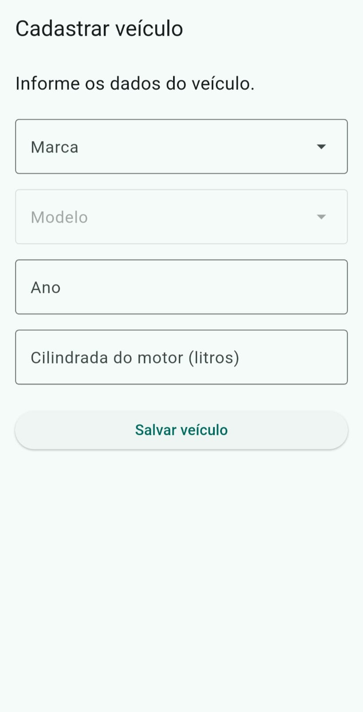
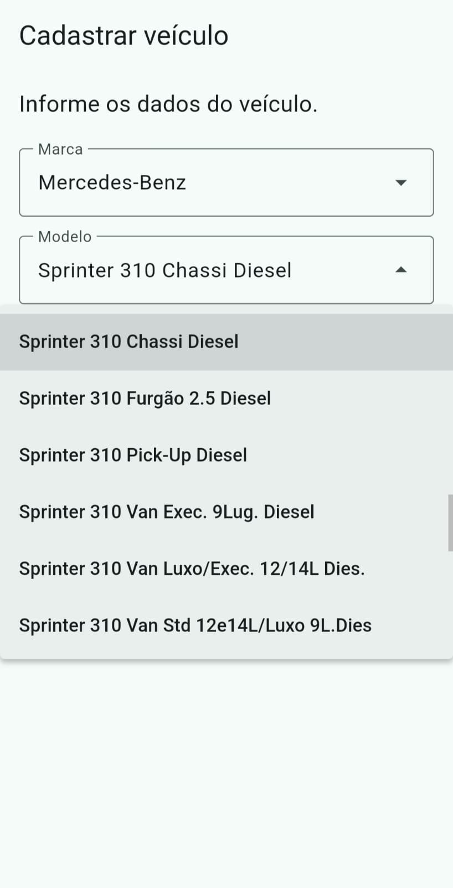
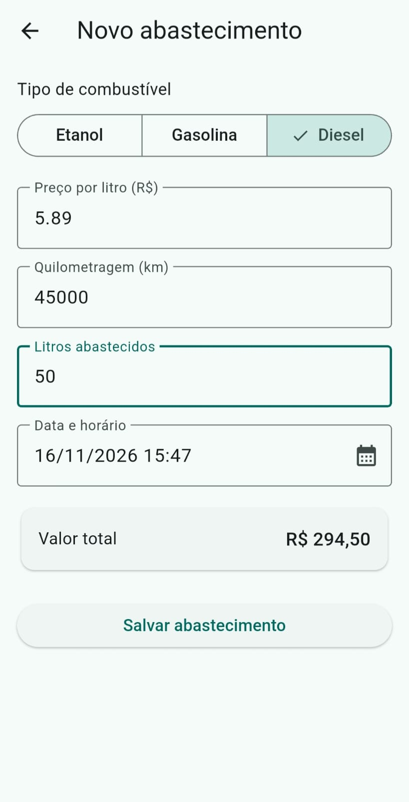
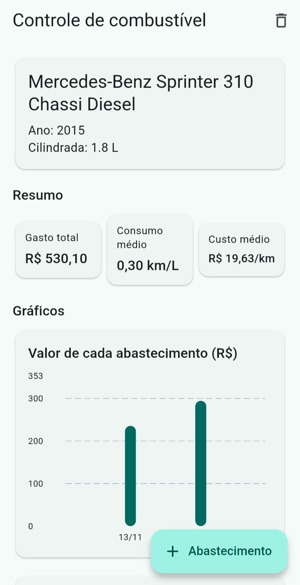
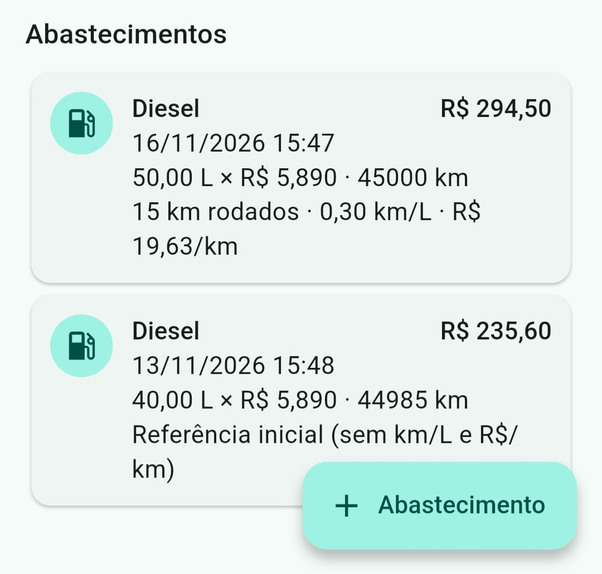
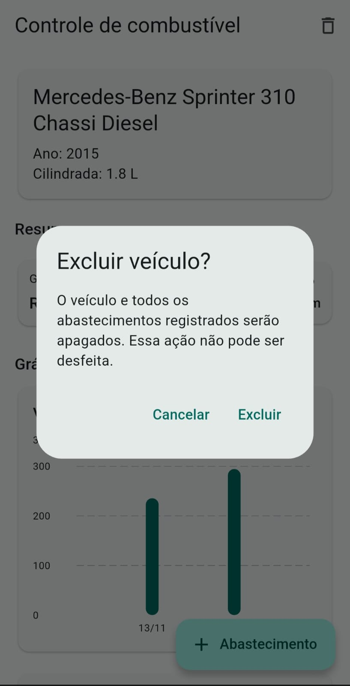

# Controle de combustível

Aplicativo Flutter para registrar os abastecimentos de um veículo e acompanhar o gasto com combustível e o consumo ao longo do tempo.

Atividade de Programação para Dispositivos Móveis II da FATEC

## Descrição

O app trabalha com **um veículo por vez**. Depois de cadastrá-lo, o usuário registra cada abastecimento e acompanha, 
em um dashboard, o valor gasto, o consumo (km/L) e o custo por quilômetro (R$/km).

### Funcionalidades

- **Cadastro do veículo:** marca, modelo, ano e cilindrada do motor. Marca e modelo vêm de uma API pública, 
    e os modelos listados dependem da marca escolhida.
- **Exclusão do veículo:** pede confirmação e remove também todos os
  abastecimentos associados a ele. Só depois disso é possível cadastrar outro.
- **Registro de abastecimentos:** tipo de combustível (etanol, gasolina ou diesel), preço por litro, quilometragem, 
    litros e data/horário. O valor total é calculado (preço por litro × litros).
- **Persistência local:** veículo e abastecimentos ficam salvos no dispositivo e continuam disponíveis depois de fechar e abrir o app.
- **Dashboard:** valor de cada abastecimento, consumo (km/L) e custo por quilômetro (R$/km), com gráficos de evolução, resumo e lista detalhada.

### Regras de cálculo

Todos os registros são considerados abastecimentos que completam o tanque. 
A partir do segundo abastecimento:

| Indicador | Cálculo |
|---|---|
| Distância percorrida | quilometragem atual - quilometragem do abastecimento anterior |
| Consumo (km/L) | distância percorrida ÷ litros do abastecimento atual |
| Custo (R$/km) | valor total do abastecimento atual ÷ distância percorrida |

O primeiro abastecimento é a referência inicial e não apresenta km/L nem R$/km.

### Validações

- Marca e modelo obrigatórios; ano entre 1900 e o ano atual + 1; cilindrada em litros (aceita `1.6` ou `1,6`).
- Preço por litro e litros maiores que zero; data e horário não podem estar no futuro.
- A quilometragem de cada abastecimento deve ser maior que a do abastecimento anterior e menor que a do seguinte, 
  considerando a data informada. Isso evita distância zero ou negativa nos cálculos.

## Como executar

### Pré-requisitos

- Flutter 3.10 ou superior
- Emulador ou dispositivo **Android**
- Conexão com a internet (para consultar marcas e modelos)

### Passos

```bash
git clone https://github.com/GabrielFrois/controle-combustivel.git
cd controle_combustivel
flutter pub get
flutter run
```

O projeto foi preparado para Android. O armazenamento local usa `sqflite`.

## API utilizada

**[BrasilAPI](https://brasilapi.com.br) módulo FIPE**, apenas para carros:

| Finalidade | Endpoint |
|---|---|
| Listar marcas | `GET https://brasilapi.com.br/api/fipe/marcas/v1/carros` |
| Listar modelos de uma marca | `GET https://brasilapi.com.br/api/fipe/veiculos/v1/carros/{codigoMarca}` |

A lista de marcas retorna `nome` e `valor` (código da marca). A lista de modelos retorna o campo `modelo`. 
O app ordena as listas, remove modelos repetidos e trata falhas de rede (tempo esgotado, sem conexão e erros 
do serviço) com mensagem e botão para tentar novamente.

## Bibliotecas adotadas

| Pacote | Uso |
|---|---|
| `sqflite` | Banco SQLite local (veículo e abastecimentos) |
| `path` | Montagem do caminho do arquivo do banco |
| `http` | Requisições à BrasilAPI |
| `fl_chart` | Gráficos de barras e de linha do dashboard |

## Estrutura do projeto

```
lib/
├── main.dart                       # Inicialização e escolha da tela inicial
├── database/
│   └── banco_app.dart              # SQLite: tabelas, veículo e abastecimentos
├── models/
│   ├── veiculo.dart
│   └── abastecimento.dart          # Inclui o enum Combustivel
├── services/
│   └── brasil_api_service.dart     # Consulta de marcas e modelos
├── telas/
│   ├── tela_cadastro_veiculo.dart  # Formulário do veículo
│   ├── tela_dashboard.dart         # Resumo, gráficos e lista
│   └── tela_novo_abastecimento.dart
├── utils/
│   ├── formatadores.dart           # Moeda, números e datas
│   └── indicadores.dart            # Cálculo de km/L e R$/km
└── widgets/
    └── graficos.dart               # Gráficos com fl_chart
```

### Persistência

Duas tabelas no SQLite, com chave estrangeira e `ON DELETE CASCADE`:

- `veiculo` (id, marca, modelo, ano, cilindrada)
- `abastecimento` (id, veiculo_id, combustivel, preco_litro, quilometragem, litros, data_hora)

A data e o horário são gravados em UTC e convertidos para o horário local na exibição.

## Capturas de tela

### Cadastro do veículo



### Seleção de marca e modelo (BrasilAPI)



### Novo abastecimento



### Dashboard com resumo e gráficos



### Lista de abastecimentos com indicadores



### Exclusão do veículo com confirmação

